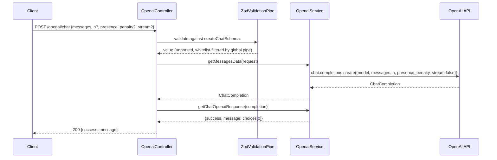
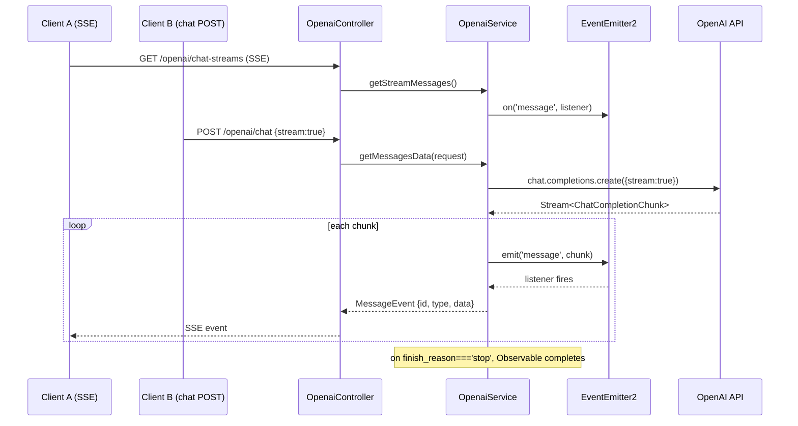
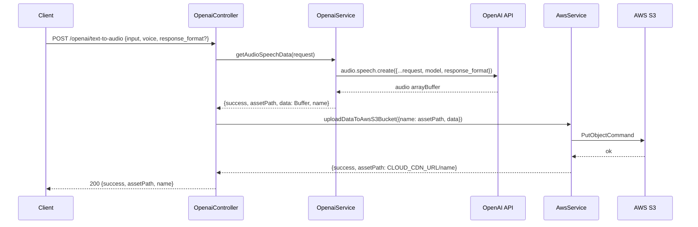
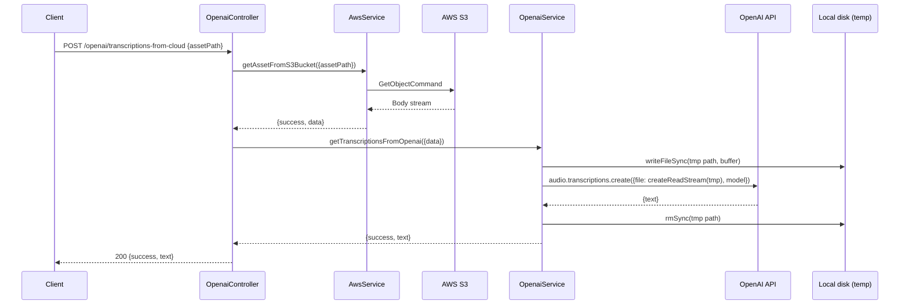
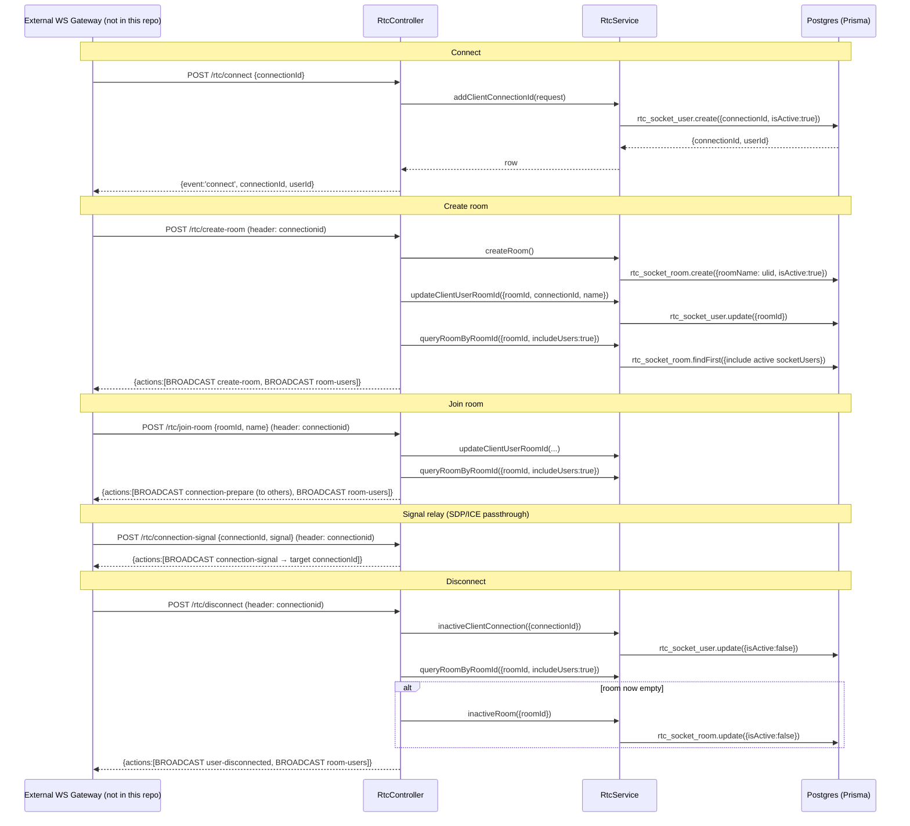
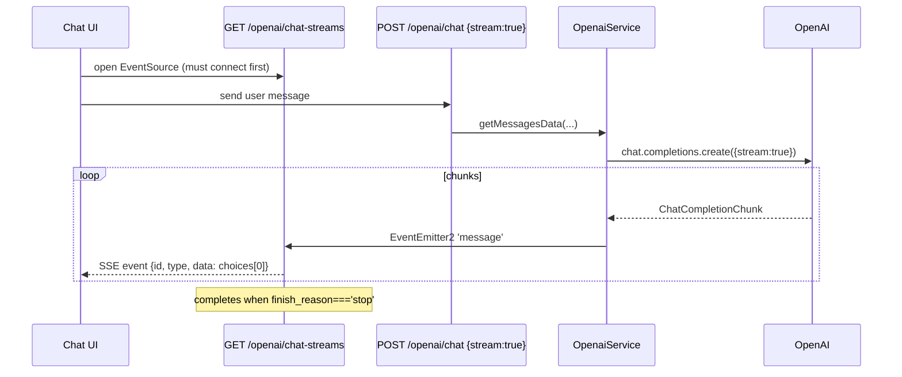
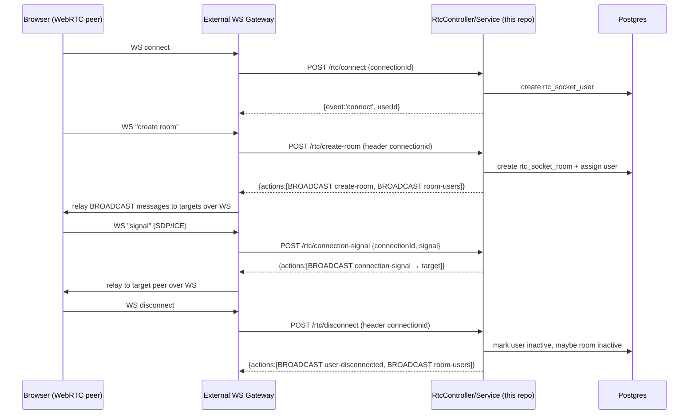

# NestJS App Architecture

> Modular NestJS (Fastify) backend for AI integrations (OpenAI, Gemini), WebRTC HTTP-signaling, and AWS S3 asset storage.

## 1. Application Summary

This is a single-tenant NestJS 11 backend (Fastify adapter) that fronts three unrelated capability groups behind one process: AI generation (OpenAI chat/TTS/transcription/image, Google Gemini chat), a stateless HTTP-based WebRTC signaling relay backed by Postgres presence tables, and a thin AWS S3 asset store used as the landing zone for OpenAI-generated audio. A small `apiip` module proxies IP geolocation lookups, and a `math` module exists purely as a benchmarking sandbox (loop-sum vs. closed-form sum) exercising the shared logging middleware. The service has **no authentication layer and wide-open CORS** — it is built as a personal/prototype API consumed by trusted first-party clients, not a public multi-tenant product. Stack: NestJS 11 + Fastify 5, TypeScript 5.9 (relaxed strictness, `strictNullChecks: false`), Prisma 7 over PostgreSQL, Zod 4 for request validation, `@nestjs/event-emitter` to bridge async provider streams into SSE. Maturity: **early/prototype** — two Prisma models, stub-only tests (`toBeDefined()`), currently on an `[Unreleased]` changelog entry pending a 0.3.0 cut.

## 2. Tech Stack & Modules

### NestJS Feature Modules

| Module | Path | Purpose | Global? |
|--------|------|---------|---------|
| `AppModule` | `src/app.module.ts` | Root module — wires all feature modules, applies `LoggerMiddleware` to `aws`, `common`, `gemini`, `openai`, `rtc` routes | — |
| `PrismaModule` | `src/prisma/` | Provides `PrismaService` (extends `PrismaClient`, DB URL from `ConfigService`) | Yes (`@Global`) |
| `AwsModule` | `src/aws/` | Provides `AwsService` — S3 `PutObject`/`GetObject` wrapper | Yes (`@Global`) |
| `CommonModule` | `src/common/` | Health check endpoint | No |
| `OpenaiModule` | `src/openai/` | Chat (sync + SSE), TTS, transcription, image generation | No |
| `GeminiModule` | `src/gemini/` | Google Gemini chat (sync + SSE) | No |
| `RtcModule` | `src/rtc/` | WebRTC signaling relay over plain HTTP POST + Postgres presence | No |
| `ApiipModule` | `src/apiip/` | IP → country lookup via apiip.com (imports `HttpModule`) | No |
| `MathModule` | `src/math/` | Sum-benchmark sandbox (loop vs. `n(n+1)/2`); applies its own `LoggerMiddleware` instance | No |

Because `PrismaModule` and `AwsModule` are `@Global()`, no other module imports them explicitly — `PrismaService` and `AwsService` are injected directly (see `RtcService`, `OpenaiController`).

### Infrastructure & Third-Party Dependencies

| Component | Version | Purpose |
|-----------|---------|---------|
| PostgreSQL | — | Sole datastore, accessed via Prisma; holds only WebRTC presence state |
| OpenAI SDK | v7.5 | Chat completions (incl. streaming), TTS (`audio.speech`), transcription (`audio.transcriptions`), image generation (`images.generate`) |
| `@google/genai` | v2.18 | Gemini chat completions (sync + stream) |
| `@aws-sdk/client-s3` | v3.451 | `PutObjectCommand` (upload) / `GetObjectCommand` (download) against one bucket |
| apiip.com | external REST API | IP geolocation, called via `@nestjs/axios` `HttpService` |
| `@nestjs/event-emitter` | v2.0 | In-process pub/sub (`'message'` event) bridging async-iterator provider streams into RxJS `Observable`s for SSE |
| PM2 | — | Production process manager (`ecosystem.config.cjs`, `pnpm pm2:start:prod`) |

### Runtime & Validation

| Component | Detail |
|-----------|--------|
| HTTP adapter | Fastify (`NestFastifyApplication`), request ID generated via `ulidx` (`genReqId`) |
| Global pipe | `ValidationPipe({ whitelist: true })` — strips unknown body properties |
| Per-route validation | Zod schemas applied via `@UsePipes(new ZodValidationPipe(schema))` — a custom pipe that calls `schema.parse()` and throws `BadRequestException` on failure, but **returns the original unparsed value**, not the parsed/coerced one (see §3 gotchas) |
| CORS | `app.enableCors()` — no options, fully open |
| Auth | None on any route |
| Tracing | `LoggerMiddleware` stamps a `traceId` (ULID) request header + response header, applied selectively via `MiddlewareConsumer.forRoutes(...)` |

---

## 3. System Architecture

### Topology

```
┌────────────────────────────────────────────────────────────────────┐
│  Client (trusted first-party — no auth, CORS open)                  │
└───────────────────────────┬───────────────────────────────────────┘
                             │ HTTP (Fastify, no auth)
                             ▼
┌────────────────────────────────────────────────────────────────────┐
│  NestJS App (single process, :NESTAPP_PORT)                        │
│                                                                      │
│  /common          health check                                     │
│  /openai/*         chat · SSE chat-streams · SSE sse · text-to-audio│
│                     · transcriptions-from-cloud · image-generation  │
│  /gemini/*         chat · SSE stream                                │
│  /rtc/*            connect · client-id · disconnect · create-room · │
│                     check-room · join-room · connection-init ·      │
│                     connection-signal                               │
│  /apiip/check      IP → country lookup                              │
│  /math/*           sum-loop · sum-multiplication (benchmark)        │
│                                                                      │
│  EventEmitter2 (in-process) — bridges OpenAI/Gemini stream chunks  │
│  into RxJS Observables consumed by @Sse() handlers                 │
└───────┬──────────────────┬──────────────────┬──────────────────────┘
        │                  │                  │
        ▼                  ▼                  ▼
┌───────────────┐  ┌───────────────┐  ┌────────────────────┐
│ PostgreSQL     │  │ AWS S3        │  │ OpenAI / Gemini /   │
│ (Prisma)       │  │ (one bucket)  │  │ apiip.com (external)│
│ rtc_socket_*   │  │ TTS output +  │  │                     │
│ presence only  │  │ transcription │  │                     │
│                │  │ source        │  │                     │
└───────────────┘  └───────────────┘  └────────────────────┘
```

### Auth Model

There is none. Every controller is reachable by any caller that can reach the port; `CORS` is enabled with no allow-list. This is a deliberate prototype posture per `CLAUDE.md` ("No auth on any endpoint") — treat the deployment boundary (network policy / reverse proxy) as the actual security boundary, not application code.

### Data Flow: OpenAI Chat (sync)



### Data Flow: OpenAI Chat (SSE) via EventEmitter2 bridge

The streaming chat endpoint and the SSE subscription endpoint are **decoupled**: `POST /openai/chat` with `stream:true` drives the OpenAI stream and emits each chunk on the shared `EventEmitter2` bus; `GET /openai/chat-streams` (an independent `@Sse()` handler) subscribes to that same bus and forwards chunks to whichever client is connected. There is no per-request correlation — any connected SSE client receives chunks from any in-flight streaming chat call.



### Data Flow: TTS (OpenAI → S3)



### Data Flow: Transcription (S3 → OpenAI)



Note: transcription round-trips through a local temp file (`OPENAI_API_TRANSCRIPTIONS_LOCAL_PATH`) because the OpenAI SDK's transcription call needs a file stream, not a raw buffer — flagged in code as a `TODO` to find a direct-from-buffer path.

### Data Flow: WebRTC Signaling (HTTP relay, not WebSocket)

`rtc` is **not** a WebSocket gateway — it is a stateless HTTP POST API where the caller supplies a `connectionid` header and the server returns an `actions: [{action: 'BROADCAST', message, targets}]` envelope. The actual fan-out to `targets` (a list of `{connectionId}`) is **not implemented in this service** — it is designed to be consumed by an external relay (e.g., a serverless WebSocket API Gateway) that reads the `actions` array and performs the broadcast. Presence (`rtc_socket_user`, `rtc_socket_room`) is persisted in Postgres via Prisma.



### Rate Limiting / Resilience

None. No rate limiting, no circuit breaking, no retries around any external call (OpenAI, Gemini, S3, apiip.com). Errors from providers are generally caught and returned as `{success:false, errorMessage}` result objects rather than thrown HTTP errors (see Conventions below) — an inconsistency across modules (`openai`/`aws` swallow-and-return; `apiip`/`gemini` largely let exceptions propagate to Nest's default exception filter).

---

## 4. Database Schema

Prisma + PostgreSQL is used **only** for WebRTC presence state — no other module touches the database.

### Table Catalog

| Model (table) | Purpose | Key Columns |
|----------------|---------|--------------|
| `rtc_socket_user` | One row per WebRTC signaling client connection | `id int @default(autoincrement())`, `userId uuid PK (@default(uuid()))`, `connectionId string UNIQUE`, `name string?`, `roomId string? FK → rtc_socket_room.roomId`, `isActive boolean @default(false)`, `createdAt`, `updatedAt` |
| `rtc_socket_room` | One row per signaling room | `id int @default(autoincrement())`, `roomId uuid PK (@default(uuid()))`, `roomName string`, `isActive boolean @default(false)`, `createdAt`, `updatedAt`, back-relation `socketUsers rtc_socket_user[]` |

**Total: 2 models, 9 migrations** (`prisma/migrations/`, spanning `20240122024732_init_socket_user` through `20240204092006_add_name_col_rtcuser`).

### Relations & Constraints

- `rtc_socket_user.roomId` → `rtc_socket_room.roomId`, **optional** (a user can exist unassigned to a room, e.g. immediately after `/rtc/connect`).
- No explicit `onDelete` behavior configured — Prisma default (`NO ACTION`/restrict at the DB level for the FK, though soft-delete via `isActive` is the actual lifecycle mechanism; no hard deletes are issued anywhere in `RtcService`).
- **Soft delete via `isActive`**: neither model is ever row-deleted; `disconnect` and "room now empty" both flip `isActive:false` rather than removing rows. Historical presence rows accumulate indefinitely — no TTL/cleanup job exists.
- `connectionId` is the only unique, non-PK identifier and is the join key used by nearly every RTC service method (`findFirst`/`update` by `connectionId`), meaning a stale/reused `connectionId` from a prior session would silently `update` the wrong logical connection.
- `userId` (user) and `roomId` (room) are both **application-generated UUIDs** via Prisma's `@default(uuid())`, not database sequences; the surrogate `id int` autoincrement columns exist but are unused by any query in the codebase (dead columns).
- `roomName` is generated from `genUlid` (see gotcha below), not a user-supplied name.

### Key Design Decisions

- **Presence-only schema**: no chat/message history, no user identity beyond a random UUID and an optional display `name` — the DB is a volatile signaling-state store, not a system of record.
- **No RLS, no tenancy column**: single-tenant by construction: nothing scopes queries by org/user beyond `connectionId`/`roomId` equality.

---

## 5. API Reference

### Common (`/common`)

| Method | Path | Handler | Auth | Description |
|--------|------|---------|------|--------------|
| GET | `/common` | `CommonController.getCommonResponse` | None | Static health check: `{success:true, message:'Nest JS is running!'}` |

### OpenAI (`/openai`)

| Method | Path | Handler | Auth | Description |
|--------|------|---------|------|--------------|
| POST | `/openai/chat` | `OpenaiController.getChatOpenai` | None | Chat completion (sync). Body validated by `createChatSchema` (`messages[]`, `n?`, `presence_penalty?`, `stream?`). Returns `{success, message: choices[0]}` |
| SSE | `/openai/chat-streams` | `OpenaiController.getChatStreamsOpenai` | None | Subscribes to the shared `EventEmitter2` bus; forwards `ChatCompletionChunk`s emitted by any in-flight `POST /openai/chat {stream:true}` call. No per-request correlation |
| SSE | `/openai/sse` | `OpenaiController.sse` | None | Demo/heartbeat endpoint — emits `{data:{hello:'world'}}` every 1s via `interval(1000)` |
| POST | `/openai/text-to-audio` | `OpenaiController.getTextToAudio` | None | TTS via `audioRequestSchema` (`input`, `voice` enum, `response_format?`), uploads result to S3, returns `IS3UploadResponse & {name}` |
| POST | `/openai/transcriptions-from-cloud` | `OpenaiController.getTranscriptionAudioToText` | None | Fetches an S3 asset (`transcriptionRequestSchema.assetPath`), round-trips through a local temp file, transcribes via OpenAI, returns `{success, text}` |
| POST | `/openai/image-generation` | `OpenaiController.getImageGenerationsApi` | None | Image generation via `imageRequestSchema.input`, returns raw OpenAI `ImagesResponse` |

### Gemini (`/gemini`)

| Method | Path | Handler | Auth | Description |
|--------|------|---------|------|--------------|
| POST | `/gemini/chat` | `GeminiController.getChatOpenai` | None | Chat completion (sync or stream-and-emit) via `createGeminiChatSchema` (`message`, `stream?`). If `stream:true`, chunks are emitted on `EventEmitter2` as a side effect and the sync body returns `{success:true, result:null}` (the aggregate text is only available over `/gemini/stream`). Otherwise returns `{success, result: text}` |
| SSE | `/gemini/stream` | `GeminiController.getChatStreamsGemini` | None | Subscribes to the shared bus, maps each chunk to `{id: genUlid, type:'message.stream.gemini', data: message.text}`. Same decoupled-bus caveat as OpenAI's SSE endpoint — plus `id` is a **module-load-time constant** (see gotchas), not per-message |

### WebRTC Signaling (`/rtc`) — HTTP relay, `connectionid` header–keyed

| Method | Path | Handler | Auth | Description |
|--------|------|---------|------|--------------|
| POST | `/rtc/connect` | `RtcController.handleRtcConnection` | None | Creates a `rtc_socket_user` row (`connectClientSchema`: `connectionId`). Returns `{event:'connect', connectionId, userId}` |
| POST | `/rtc/client-id` | `RtcController.handleGetClientId` | None | Looks up the active user by `connectionid` header. Returns a `BROADCAST` action envelope targeting the same connection |
| POST | `/rtc/disconnect` | `RtcController.handleRtcDisconnect` | None | Marks the user inactive; if the room they were in has no other active users, marks the room inactive too. Returns `BROADCAST user-disconnected` + `BROADCAST room-users` actions |
| POST | `/rtc/create-room` | `RtcController.handleCreateRoom` | None | Creates a `rtc_socket_room` (name = generated ULID), assigns the caller to it. Returns `BROADCAST create-room` (to caller) + `BROADCAST room-users` (to room) actions |
| POST | `/rtc/check-room` | `RtcController.handleCheckRoomAvailability` | None | `roomSchema`-validated (`roomId`). Returns `{success:false, errorMsg}` if the room is missing/inactive, else the room + its active users |
| POST | `/rtc/join-room` | `RtcController.handleJoinRoom` | None | `roomSchema`-validated (`roomId`, `name?`). Assigns caller to the room. Returns `BROADCAST connection-prepare` (to all *other* room members) + `BROADCAST room-users` actions |
| POST | `/rtc/connection-init` | `RtcController.handleConnectionInit` | None | `connectClientSchema`-validated. Pure relay — no DB write; returns a `BROADCAST connection-init` action targeting the request's `connectionId` |
| POST | `/rtc/connection-signal` | `RtcController.handleConnectionSignal` | None | `signalSchema`-validated (`connectionId`, `signal: any`). Pure relay — no DB write; returns a `BROADCAST connection-signal` action carrying the opaque `signal` payload (SDP/ICE) targeting `connectionId` |

All `/rtc/*` handlers except `/connect`, `/check-room`, `/join-room`, `/connection-init`, and `/connection-signal` read an ambient `connectionid` request header (not part of the Zod-validated body) via `@Req()` — this is an implicit, unvalidated auth-adjacent identifier.

### ApiIP (`/apiip`)

| Method | Path | Handler | Auth | Description |
|--------|------|---------|------|--------------|
| GET | `/apiip/check?ip=...` | `ApiipController.getClientCountry` | None | Proxies to `apiip.com` (`APIIP_CHECK_URL?ip=...&accessKey=APIIP_KEY`) via `HttpService`. Returns `{success, country}` (empty string if `countryName` absent) |

### Math (`/math`) — benchmark sandbox

| Method | Path | Handler | Auth | Description |
|--------|------|---------|------|--------------|
| POST | `/math/sum-loop` | `MathController.getSumResponseWithLoop` | None | Sums `1..number` via a `for` loop. `createSumSchema`-validated (`number`). Returns `{success, result, timeInMili}` |
| POST | `/math/sum-multiplication` | `MathController.getSumResponseWithMultiplication` | None | Sums `1..number` via `n(n+1)/2`. Same request/response shape — exists to compare wall-clock cost against the loop variant |

---

## 6. Consumer/Client Flows

This is a backend-only service with no bundled frontend. This section describes how a client is expected to drive each module group.

### AI Chat Consumer (OpenAI / Gemini)

**Who:** A frontend chat UI (not in this repo — README notes "need to integrate it from front-end side to make it clearer").

**Sync path:** `POST /openai/chat` or `POST /gemini/chat` → render `message`/`result` directly.

**Streaming path:** the client must open the SSE connection **before** triggering the streaming POST, since the bus has no buffering/replay and no per-client correlation — any chunk emitted while the SSE client isn't yet subscribed is lost, and if two streaming requests are in flight concurrently, one SSE client will receive an interleaved mix of both.



### Audio Pipeline Consumer (TTS + Transcription)

**Who:** Any client wanting speech output or speech-to-text, using S3 as the intermediate asset store rather than a direct binary response.

1. **TTS:** `POST /openai/text-to-audio {input, voice}` → client receives `{assetPath, name}` (a CDN URL), fetches the audio file directly from `CLOUD_CDN_URL`, not from the API response body.
2. **Transcription:** caller must already have an S3 `assetPath` (e.g., from a prior upload elsewhere, or from step 1) → `POST /openai/transcriptions-from-cloud {assetPath}` → `{text}`.

### WebRTC Signaling Consumer

**Who:** An external WebSocket gateway (e.g., a serverless API Gateway + Lambda-style relay) that terminates persistent WebSocket connections from browsers, translates each inbound WS message into one of the `/rtc/*` HTTP calls (stamping the `connectionid` header from its own connection registry), and — critically — **performs the actual fan-out** described by the returned `actions[].targets` array. This service never opens a socket itself; it is the presence/state and message-shaping backend behind such a gateway.



### Geolocation Consumer

**Who:** Any client wanting a coarse country lookup for a given IP, e.g. for locale defaulting. `GET /apiip/check?ip=1.2.3.4` → `{success, country}`. No caching — every call round-trips to apiip.com.

### Benchmark Consumer

**Who:** Internal — used to compare loop-based vs. closed-form summation latency (`POST /math/sum-loop` vs `POST /math/sum-multiplication`, same `{number}` body). Not part of any product surface; exists to exercise `LoggerMiddleware` and demonstrate the Zod-pipe pattern.

---

## 7. Endpoint-to-Consumer Reverse Map

| Endpoint | Method | Consumer Flow | Service/Orchestrator |
|----------|--------|----------------|------------------------|
| `/common` | GET | Health probe (infra/uptime check) | `CommonService` |
| `/openai/chat` | POST | AI Chat Consumer | `OpenaiService.getMessagesData` + `getChatOpenaiResponse` |
| `/openai/chat-streams` | SSE | AI Chat Consumer (streaming) | `OpenaiService.getStreamMessages` (via `EventEmitter2`) |
| `/openai/sse` | SSE | Demo/heartbeat — no product consumer | inline controller (`interval(1000)`) |
| `/openai/text-to-audio` | POST | Audio Pipeline Consumer | `OpenaiService.getAudioSpeechData` → `AwsService.uploadDataToAwsS3Bucket` |
| `/openai/transcriptions-from-cloud` | POST | Audio Pipeline Consumer | `AwsService.getAssetFromS3Bucket` → `OpenaiService.getTranscriptionsFromOpenai` |
| `/openai/image-generation` | POST | AI Chat Consumer (adjacent — image gen) | `OpenaiService.getImageGenerations` |
| `/gemini/chat` | POST | AI Chat Consumer | `GeminiService.getMessagesData` + `getChatResponse` |
| `/gemini/stream` | SSE | AI Chat Consumer (streaming) | `GeminiService.getStreamMessages` (via `EventEmitter2`) |
| `/rtc/connect` | POST | WebRTC Signaling Consumer | `RtcService.addClientConnectionId` |
| `/rtc/client-id` | POST | WebRTC Signaling Consumer | `RtcService.getClientData` |
| `/rtc/disconnect` | POST | WebRTC Signaling Consumer | `RtcService.inactiveClientConnection` + `queryRoomByRoomId` + `inactiveRoom` |
| `/rtc/create-room` | POST | WebRTC Signaling Consumer | `RtcService.createRoom` + `updateClientUserRoomId` + `queryRoomByRoomId` |
| `/rtc/check-room` | POST | WebRTC Signaling Consumer | `RtcService.queryRoomByRoomId` |
| `/rtc/join-room` | POST | WebRTC Signaling Consumer | `RtcService.updateClientUserRoomId` + `queryRoomByRoomId` |
| `/rtc/connection-init` | POST | WebRTC Signaling Consumer | Pure relay (no service DB call) |
| `/rtc/connection-signal` | POST | WebRTC Signaling Consumer | Pure relay (no service DB call) |
| `/apiip/check` | GET | Geolocation Consumer | `ApiipService.getClientCountry` + `generateCountryResponse` |
| `/math/sum-loop` | POST | Benchmark Consumer | `MathService.generateSumWithLoop` |
| `/math/sum-multiplication` | POST | Benchmark Consumer | `MathService.generateSumWithMultiplication` |

---

## Known Gotchas (carried from `CLAUDE.md`, verified in code)

- **No auth, wide-open CORS** — `app.enableCors()` with no config; treat network boundary as the real security perimeter.
- **`ZodValidationPipe` validates but doesn't transform** — `transform()` calls `schema.parse(value)` for its throw-on-invalid side effect, then returns the *original* `value`, not the parsed result. Zod defaults (e.g., `stream.default(false)`) never actually populate the object seen by controllers; every optional field must be defensively defaulted again in the service (e.g., `request.stream || false`, `request.n || 1`).
- **`genUlid` is a module-load-time constant** (`src/utils/ulid.ts`: `export const genUlid: string = ulid().toString();`), not a function. Every call site that "generates" an ID from it (`audio-${genUlid}.mp3`, `rtc_socket_room.roomName: genUlid`, Gemini SSE `id`) reuses the **same ULID for the process lifetime**, causing filename collisions and non-unique room names/event IDs across requests.
- **RTC "broadcast" actions are not executed by this service** — `/rtc/*` returns an `actions[].targets` envelope; an external WebSocket relay is required to actually deliver messages. This repo alone cannot signal two peers to each other.
- **`LoggerMiddleware` traceId is best-effort** — checks `req.headers?.traceId` (lowercase `traceId`, which Node normalizes to lowercase anyway) but writes via `res.setHeader('traceId', traceId)`; applied only to the routes listed in `AppModule.configure()` plus a redundant second registration in `MathModule`.
- **Tests are stubs** — Jest specs exist per module but assert `toBeDefined()` only; no behavioral coverage.
- **`package.json` name (`nest-be`) diverges from the directory name (`nestjs-app`)**.
